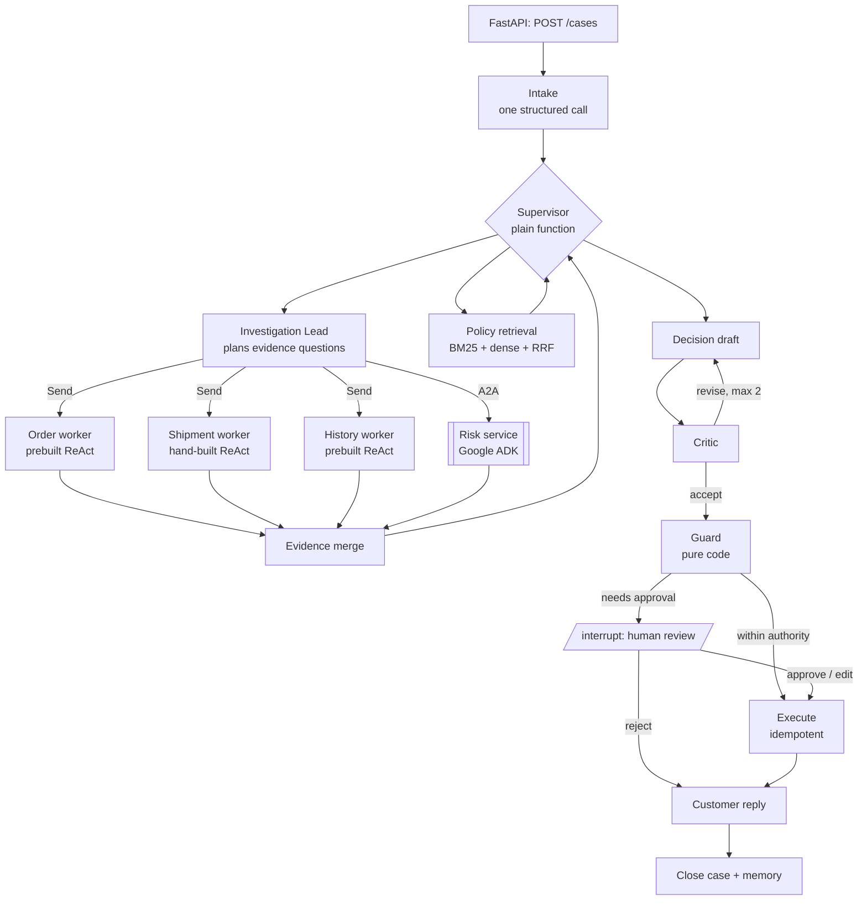
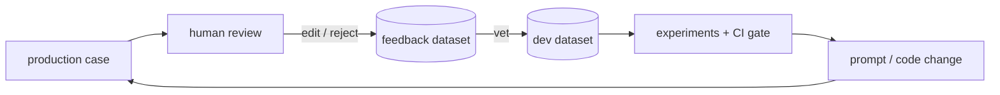

# Refund Desk

An autonomous refund-request resolver. A customer writes "my order arrived broken, I want my money
back"; Refund Desk gathers the evidence, finds the policy clauses that apply, decides
approve / partial / deny / escalate with an amount, has the decision challenged by a critic, and then
either issues the refund itself or parks the case for a human, with a full audit trail.

> Use the least agentic thing that works at each step, and let code, not the prompt, hold every rule
> that must never be broken.

Design: [IMPLEMENTATION.md](IMPLEMENTATION.md). Architecture notes and decisions: [docs/](docs/).

## Status: what has and has not been run

| Part | State |
|---|---|
| Oracle, scenario generator, guards, tools, retrieval, payments, redaction, circuit breaker | Unit-tested, passing |
| Full graph (intake, supervisor, lead + 3 workers, merge, policy, draft, critic, guard, human review, execute, reply) | Run end to end with scripted fake models, passing (incl. a "perfect model" over 48 generated scenarios for configs B–E: outcome 100 %, 0 unsafe) |
| Interrupt / kill the process / resume / exactly one refund | Verified across a real process kill with file-backed SQLite checkpoints |
| A2A: ADK server <-> LangGraph client | Verified against the real ADK A2A server with a stubbed agent; service-down and breaker verified |
| Security: a *compromised* model that obeys injections cannot move money past the guard | Tested |
| **Real model calls** (Gemini on both sides: `google_genai:` in the graph, native Gemini in the ADK service) | **Not run.** No API keys were available; the Gemini model id in `config.py` is unverified against your key. Prompts, the ADK agent instructions (`{risk_review?}` state templating, tool use) and structured-output behaviour are untested against live models |
| **Postgres, pgvector, `AsyncPostgresSaver`, Docker Compose** | **Not run.** No Docker daemon was available. `services/refund_desk/tests/e2e/test_postgres.py` is written and skipped without `E2E_PG_URL` |
| **Ablation table** | **Empty on purpose** (below). Nothing was measured |
| LLM judges | Written, **uncalibrated** — `python -m evals.calibrate` produces the sheet you label |

Verified versions: langgraph 1.2.22, langchain 1.5.0, google-adk 2.14.1,
a2a-sdk 1.3.0, langsmith 0.14.17 (pinned in `uv.lock`). Names the design doc flagged as unchecked,
now checked against these: `add_node(retry_policy=...)` ✔, `langchain.agents.create_agent` + middleware ✔,
`google.adk.a2a.utils.agent_to_a2a.to_a2a` ✔, A2A client `a2a.client.create_client` (protobuf types) ✔.
ADK 2.x marks `SequentialAgent` / `ParallelAgent` / `LoopAgent` deprecated in favour of `Workflow`; this
repo keeps them because the design names them.

## Architecture



Feedback loop: human edits and rejections are recorded by `app/feedback.py` (LangSmith dataset
`refund-desk-feedback`, or `data/feedback/reviews.jsonl` without a key), vetted, and promoted into
`refund-desk-dev`, so reviewers' corrections become tomorrow's evaluation cases.



## Run it

Everything below that calls a model needs real keys: copy `.env.example` to `.env` and replace the
placeholders (`GOOGLE_API_KEY`, `LANGSMITH_API_KEY`, `POSTGRES_PASSWORD`,
`REVIEWER_TOKEN`).

```bash
# tests: no network, no keys
uv venv --python 3.12 && uv pip install -e ".[dev,risk]"
uv run pytest

# the stack
docker compose up --build
python scripts/demo.py                       # three scripted cases (auto-approve, human review, deny)
```

API: `POST /cases` · `GET /cases/{id}` · `GET /cases/{id}/events` (SSE) · `POST /cases/{id}/review` ·
`/healthz` · `/readyz`. Customers see only the reply and status; the decision, guard reasons and
pending review need the reviewer token.

### Evaluation

```bash
python -m evals.generate [--llm] [--upload]  # 160 scenarios -> data/scenarios, hand-check sheet, LangSmith datasets
python -m evals.run --config E --split dev --repeats 3
python -m evals.ablation run --split dev --repeats 3     # configs A..E, real model calls
python -m evals.ablation table evals/results/*.json      # table from saved runs only
python -m evals.smoke                                    # the CI gate
```

Evaluation runs need the risk service reachable (`uvicorn risk_service.serve:app --port 8001`) and
both processes pointed at the same `DATABASE_URL` (the risk service reads the seeded signals).
Set blended prices in `evals/pricing.json`, or cost is reported as 0 and the table says so.

## Ablation

| Config | Outcome acc. | Mean amount error | Unsafe actions | Escalation rate | Cost / case | p95 latency |
|---|---|---|---|---|---|---|
| A. Single ReAct | | | | | | |
| B. Pipeline | | | | | | |
| C. Full minus critic | | | | | | |
| D. Full minus hierarchy | | | | | | |
| E. Full | | | | | | |

Not run. Fill it only from `python -m evals.ablation` output, and report gaps inside run-to-run spread
as "no measurable difference". If A lands close to E on accuracy, argue for E on unsafe actions,
auditability and failure isolation, or concede the point.

Config notes: A has no intake, risk, guard or human step and acts on its own decision (so its unsafe
count is the baseline's honest risk). B is the full graph with `lead_plan` replaced by a fixed
sequence in code and no critic. C and D are switches (`REFUND_DESK_CRITIC_ENABLED=false`,
`REFUND_DESK_HIERARCHY_ENABLED=false`). With the critic off, its cheap code checks go too.

## Decisions

- **The supervisor is code.** The order of phases is fixed; an LLM router would be a pattern for its own sake. The model-driven delegation is one level down, in the lead.
- **The critic sees less than the drafter.** Draft, clauses, evidence — not the drafter's reasoning — so it cannot simply agree with an argument it never saw. Cheap code checks run first and cost no tokens.
- **The guard has no model.** Authority, order-total cap, risk, confidence and unresolved critique are code. `risk is None` escalates, so a down specialist makes the system more cautious.
- **Execute has no model and no retry.** The idempotency key (`case_id:refund`, UNIQUE in the database) covers replays, retries and double clicks.
- **Risk is a separate service in a different framework.** It models a specialist owned by another team, reached over A2A. You could build it in LangGraph; the boundary is the point.
- **Workers never see the customer message.** They get one question and ids. Only intake reads the raw text; everything after sees a structured summary.
- **"Customer supplied a photo" comes from the upload, not the text.** A model reading "I attached a photo" is not evidence of one.
- **Tool access is bound, not asked for.** `customer_id` is baked into each tool set from the session; it is not a tool argument, and another customer's order looks exactly like a missing one.

## Known limitations

- Synthetic data and a simulated backend; ground truth is an oracle written by the same author as the policy. The 20-case hand-check sheet (`data/scenarios/handcheck.md`) was reviewed against the policy text by Claude in the session that built it (all 20 consistent); that is not an independent human review.
- Templated customer messages by default (`--llm` for model-written ones). Templates are less varied than real customers.
- LLM judge agreement is unmeasured until you label `data/judge_labels.todo.jsonl`.
- Dense retrieval uses a deterministic hashing embedder, not a trained one; with 25 short clauses BM25 does most of the work.
- Nodes are synchronous functions (the graph runs them in worker threads); database calls block a thread, not the event loop.
- The risk service's score is the model's arithmetic over tool outputs, then normalised in code (level derived from score). The rubric matches the oracle's `derive_risk` (tested), but live-model accuracy is unmeasured.
- Auth is simulated (bearer-token map or `X-Customer-Id` in dev).
- Interrupt resume with Postgres is untested here; the same mechanism is tested with SQLite.
